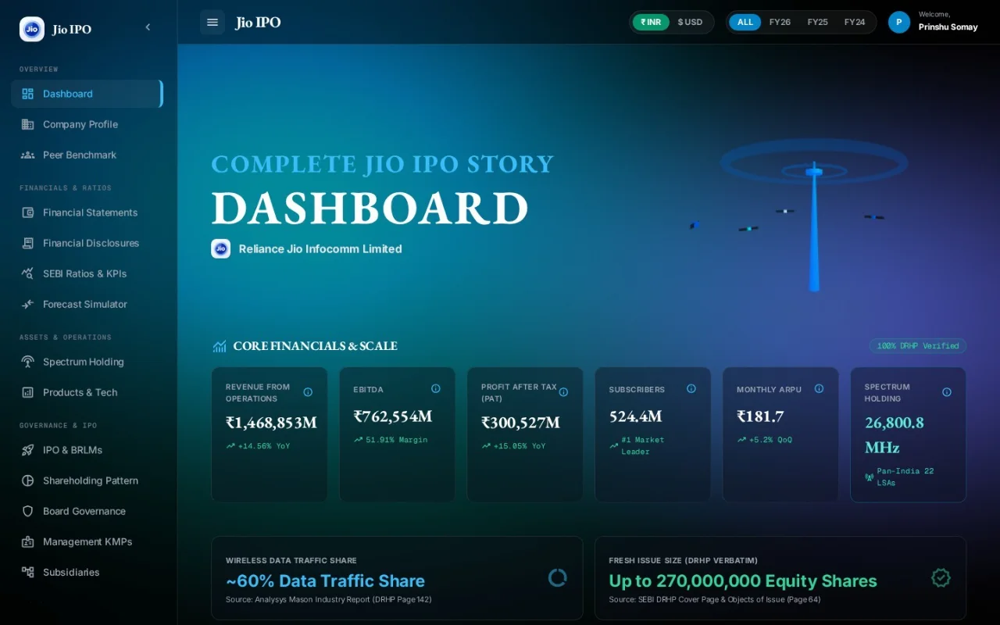

# Jio IPO Terminal

A research terminal for the proposed IPO of Jio Platforms Limited, built from its draft red herring prospectus (DRHP) dated June 19, 2026.

**Live:** https://jio-ipo.vercel.app



## What's in it

The 528-page DRHP is broken into seventeen views:

| Section | Views |
| --- | --- |
| Overview | Dashboard, company profile, peer benchmark |
| Financials | Financial statements, financial disclosures, SEBI ratios and KPIs, FY27 forecast simulator |
| Operations | Spectrum holding, products and technology |
| Offer and governance | IPO structure and book running lead managers, shareholding pattern, board, key managerial personnel, subsidiaries |
| Risk | Risk factors, litigation and tax, corporate history |

The forecast simulator lets you change the FY27 assumptions and see the projected figures move.

## Data

Every figure the site shows is in [`data/jioBundle.js`](data/jioBundle.js), held in a single `window.JioData` object. The figures are taken from the DRHP. The industry figures come from the Analysys Mason report quoted in it.

I also built a 37-worksheet Excel data model from the same DRHP, structured to load into Power BI. It isn't part of this repository.

## How it's built

- **Page:** plain HTML, CSS and JavaScript, with no framework and no build step.
- **Charts:** Apache ECharts.
- **Styling:** Tailwind CSS from its CDN.
- **Signal tower on the dashboard:** Three.js.
- **Icons:** Lucide.

The site is hosted on Vercel. Every push to `main` deploys it.

To run it locally, serve the folder with any static server and open http://localhost:8080:

```
python -m http.server 8080
```

## Note

This is an independent student project. It is not affiliated with Jio Platforms, Reliance Jio Infocomm or Reliance Industries, and nothing in it is investment advice. Check the DRHP itself before relying on any figure.

---

Built by **Prinshu Somay**, Bachelor of Management Studies, IIM Sirmaur.

[Portfolio](https://prinshusomay.github.io) · [LinkedIn](https://www.linkedin.com/in/prinshusomay)
